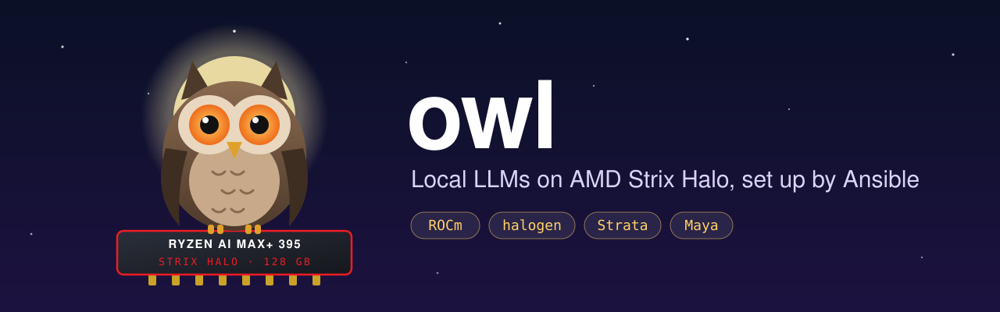
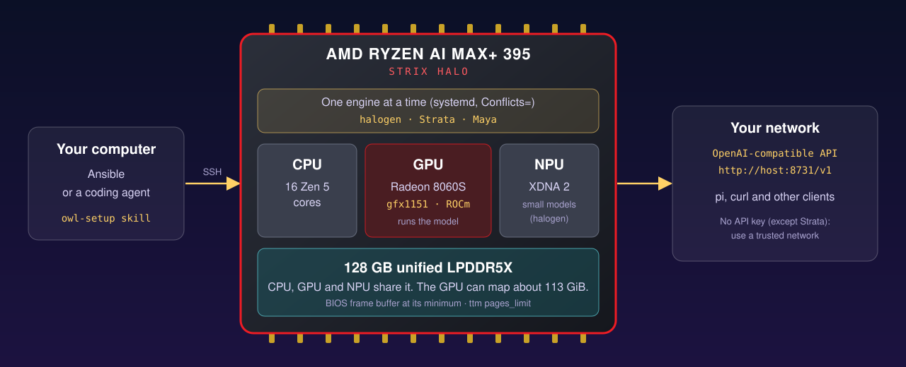

# owl



Ansible playbooks that set up an AMD Strix Halo machine (Ryzen AI Max+ 395, 128 GB) to run large language models.
They install ROCm and one or more inference engines on Ubuntu Server 26.04 LTS. Each engine serves an
OpenAI-compatible API on your network.

Tested on a GMKtec EVO-X2 with 128 GB.



## Before you start

- **Machine:** a Ryzen AI Max+ 395 with 128 GB. `ubuntu.yml` stops if Linux sees less than about 115 GB.
- **Disk:** about 120 GB for halogen, about 900 GB for all engines.
- **Security:** `ubuntu.yml` gives your user passwordless sudo. The engines, except Strata, serve
  without an API key to all of your network. Use them only on a trusted network.

## Engines

The table shows the models that Owl's playbooks install. Each engine can support other models too.

| Engine | Model installed by Owl | Port | Playbook |
|--------|-------|------|----------|
| [halogen](https://github.com/peonist-ai/halogen-flash-server) (default, closed source, free under an EULA) | Qwen3.8-Flash-Next, optional abliterated | 8731 | `halogen.yml` |
| [Strata](https://github.com/Niko1221/Strata) | Qwen3.8-Flash-Next | 8080 | `strata.yml` |
| [gufo](https://github.com/gufo-org/gufo) | Qwen3.8-Flash-Next, optional abliterated | 8081 | `gufo.yml` |
| [libosmos](https://github.com/mrsirg97-rgb/libosmos) | DeepSeek-V4.1-Flash, abliterated | 8091 | `libosmos.yml` |
| [Project Maya](https://github.com/mw00/project-maya) | DeepSeek-V4.1-Flash | 8099 | `maya.yml` |

Each engine uses almost all of the memory, so only one runs at a time. See [docs/03-engines.md](docs/03-engines.md).

### Other model options

Some other models fit a 128 GB Strix Halo. Upstream support does not mean that Owl installs or tests that model.

- Maya also supports GLM-5.3-Flash and MiniMax-M3.1-Flash. Its smaller quants are options for 128 GB machines.
- Strata also supports Qwen3.6-35B-A3B. libosmos also supports Qwen3.8-Flash-Next.
- gufo also supports Qwen3.8-27B, embeddings, speech, images and video.
- halogen can serve small NPU models beside Qwen Flash. Set `halogen_npu_models` to select them.

The full GLM-5.3 model needs more memory than GLM-5.3-Flash. On 128 GB, its Maya-XS quant must read some experts from SSD.
See [other models and memory limits](docs/03-engines.md#other-models-and-memory-limits) before you choose a model.

## Set up with an AI agent

Clone the repository and start your coding agent in it (Claude Code, Codex, pi or another agent that reads `AGENTS.md`).
Then ask:

> Use the owl-setup skill to set up my Strix Halo at `<host>` as user `<user>`.

The agent follows the [owl-setup skill](.agents/skills/owl-setup/SKILL.md). It stops for the steps that only you
can do: the BIOS, the Ubuntu install and the sudo password.

## Quick start

1. Install Ubuntu Server 26.04 LTS, set the BIOS frame buffer to the minimum and allow passwordless sudo.
   See [docs/01-ubuntu-install.md](docs/01-ubuntu-install.md).
2. On your computer, get the repository, Ansible and the collections:

   ```sh
   git clone https://github.com/jwmoss/owl && cd owl/ansible
   uv tool install ansible-core
   ansible-galaxy collection install -r requirements.yml
   ```

3. Copy `inventory/hosts.example.yml` to `inventory/hosts.yml`. Set your machine's address and user.
4. Optional: run `hf auth login` on your computer. Ansible copies the token, and downloads are faster.
5. Set up Ubuntu and halogen (about 120 GB of downloads), then test it:

   ```sh
   ansible-playbook ubuntu.yml halogen.yml
   ansible-playbook test.yml -e '{"engines": ["halogen"]}'
   ```

   `ubuntu.yml` reboots the machine one time to apply the GPU memory limit.

6. Check the API:

   ```sh
   curl http://<host>:8731/health
   ```

## Playbooks

| Playbook | Does |
|----------|------|
| `ubuntu.yml` | Build tools, passwordless sudo, GPU groups, Hugging Face CLI, ROCm, GPU memory limit |
| `<engine>.yml` | One engine, its model and its systemd service |
| `site.yml` | `ubuntu.yml` and all engines (about 900 GB of downloads) |
| `tailscale.yml` | Optional. Installs [Tailscale](https://tailscale.com) and joins your tailnet. `site.yml` does not run it |
| `test.yml` | Starts each installed engine, sends one chat request and checks the answer |

Settings, such as the engine that starts at boot (`default_engine`), are in
[`ansible/inventory/group_vars/all.yml`](ansible/inventory/group_vars/all.yml).
To change a setting for one machine, put it in `ansible/inventory/host_vars/<host>.yml` (gitignored), for example:

```yaml
default_engine: gufo
gufo_abliterated: true   # gufo runs huihui-ai's abliterated Qwen3.8-Flash-Next
```

### Tailscale

Tailscale lets you reach the engines from outside your home network. Run `ansible-playbook tailscale.yml`.
It installs Tailscale, shows a login URL and waits up to 10 minutes. Open the URL to add the machine to your tailnet.

To log in without a browser, use an auth key:

1. Make an auth key in the [Tailscale admin console](https://login.tailscale.com/admin/settings/keys).
   A one-off key with a tag is safest. A tagged device does not expire, and access controls can limit it.
2. Put the key in `~/.config/tailscale/authkey` on your computer, outside the repo, and run `chmod 600` on it.
3. Run `ansible-playbook tailscale.yml`.

Every device on your tailnet can then reach the engines, and most engines have no API key.
Use [Tailscale access controls](https://tailscale.com/kb/1018/acls) to limit which devices can.

## Documents

1. [Ubuntu install](docs/01-ubuntu-install.md)
2. [ROCm and GPU memory](docs/02-rocm.md)
3. [Inference engines and models](docs/03-engines.md)
4. [State transitions and recovery](docs/04-state-transitions.md)

## Versions

Renovate reads the annotated version pins in `ansible/inventory/group_vars/all.yml` and proposes updates through pull requests.
It does not add new model choices or deploy updates. Run the relevant setup and test playbooks before you merge an update.

Each release is a tag (`vX.Y.Z`) with notes in [CHANGELOG.md](CHANGELOG.md) and on the
[releases page](https://github.com/jwmoss/owl/releases).

- **Major:** you must change something by hand, for example a renamed setting.
- **Minor:** a new engine, a new setting or a new engine version. The next run downloads or runs something different.
- **Patch:** a fix that does not change what gets installed.

## License

[MIT](LICENSE). The engines and the models have their own licenses. halogen is closed source under its EULA.
