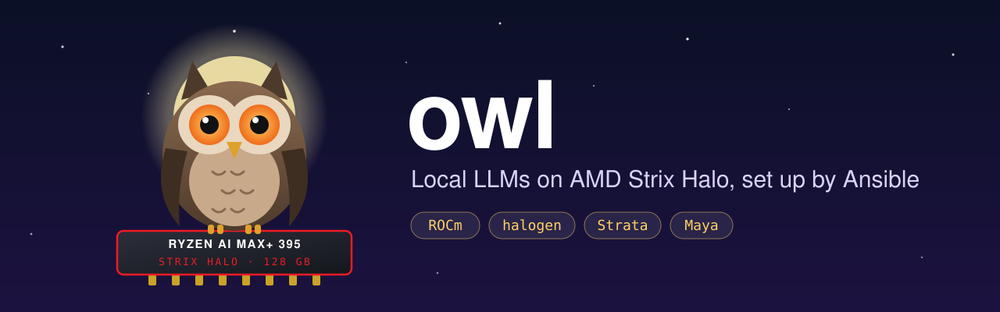
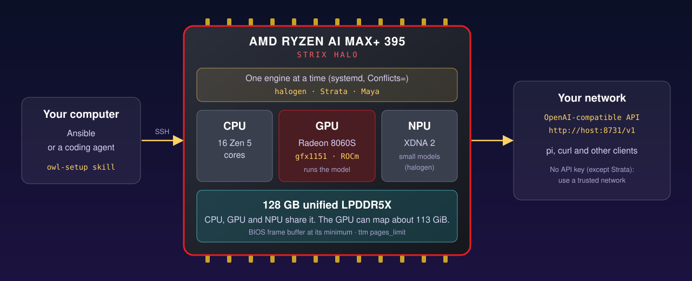

# owl



Ansible playbooks that set up an AMD Strix Halo machine (Ryzen AI Max+ 395, 128 GB) to run large language models.
They install ROCm and one or more inference engines on Ubuntu Server 26.04 LTS. Each engine serves an
OpenAI-compatible API on your network.

Tested on a GMKtec EVO-X2 with 128 GB.



## Measured speed

Measured on a GMKtec EVO-X2 (Ryzen AI Max+ 395, 128 GB) on 2026-11-26, with each engine's own bench, at the
versions that `main` pins. The [run record](docs/benchmarks/2026-11-26/README.md) has the raw output of each bench,
the engine commits and image digests, and the Hugging Face commit and SHA-256 of every model file, also as
[CycloneDX](docs/benchmarks/2026-11-26/sbom.cdx.json) and [SPDX](docs/benchmarks/2026-11-26/sbom.spdx.json) SBOMs.
[All runs](docs/benchmarks/README.md), with a `results.csv` for each run to search or compare.

| Engine | Model (Hugging Face) | Quant | Context | Decode tok/s | Prompt tok/s ¹ |
|---|---|---|---:|---:|---:|
| halogen 0.20.7 | [`peonist-ai/halogen-qwen3.8-flash-next`](https://huggingface.co/peonist-ai/halogen-qwen3.8-flash-next) | v2 `.hgn` | 256K | **73.0** | 2350 |
| halogen 0.20.7 | [`Quat3rnion/halogen-qwen3.8-flash-next-v2-abliterated`](https://huggingface.co/Quat3rnion/halogen-qwen3.8-flash-next-v2-abliterated) | v2 `.hgn` | 256K | **71.1** | 2354 |
| Strata 0.2.22 | [`ISTA-DASLab/Qwen3.8-Flash-Next-GSQ-RCO-GGUF`](https://huggingface.co/ISTA-DASLab/Qwen3.8-Flash-Next-GSQ-RCO-GGUF) | IQ3_S | 128K | **49.5** | 806 |
| Maya v1.1.81 | [`unsloth/Inkling-2-Mini-GGUF`](https://huggingface.co/unsloth/Inkling-2-Mini-GGUF) | UD-Q4_K_XL | 256K | **47.8** | 1038 |
| Maya v1.1.81 | [`peasantsmith/DeepSeek-V4.1-Flash-1017-Maya-GGUF`](https://huggingface.co/peasantsmith/DeepSeek-V4.1-Flash-1017-Maya-GGUF) | Maya-XS v2 | 256K | **32.9** | 448 |
| Maya v1.1.81 | [`orcarouter/DeepSeek-V4.1-Flash-1017-abliterated-GGUF`](https://huggingface.co/orcarouter/DeepSeek-V4.1-Flash-1017-abliterated-GGUF) | Mix-128G | 256K | **29.5** | 452 |
| Strata 0.2.22 | [`strata-engine/Inkling-2-Mini-Strata`](https://huggingface.co/strata-engine/Inkling-2-Mini-Strata) | SQ-20 | 128K | **28.0** | 758 |
| Maya v1.1.81 | [`peasantsmith/GLM-5.3-Flash-Maya-GGUF`](https://huggingface.co/peasantsmith/GLM-5.3-Flash-Maya-GGUF) | Maya-S v2 IQ2_XXS | 32K | **27.1** | 270 |
| Strata 0.2.22 | [`strata-engine/Hy4-Flash-Strata`](https://huggingface.co/strata-engine/Hy4-Flash-Strata) | SQ-96 | 128K | **25.8** | 600 |
| Maya v1.1.81 | [`peasantsmith/Hy4-Flash-Maya-GGUF`](https://huggingface.co/peasantsmith/Hy4-Flash-Maya-GGUF) | Maya-L IQ4_XS | 32K | **22.4** | 205 |
| Maya v1.1.81 | [`peasantsmith/GLM-5.3-Flash-Maya-M-Derisked-IQ2_S-GGUF`](https://huggingface.co/peasantsmith/GLM-5.3-Flash-Maya-M-Derisked-IQ2_S-GGUF) | IQ2_S | 256K | **16.9** | 250 |

¹ The longest prompt of each bench: about 11K tokens for halogen (from [halogen-prompt.py](docs/benchmarks/halogen-prompt.py),
because halogen's bench does not measure prompts), 8K for Maya and 16K for Strata. Decode is for 256-token answers.

## Before you start

- **Machine:** a Ryzen AI Max+ 395 with 128 GB. `ubuntu.yml` stops if Linux sees less than about 115 GB.
- **Disk:** about 120 GB for halogen, about 600 GB for all engines and their default models.
- **Security:** `ubuntu.yml` gives your user passwordless sudo. The engines, except Strata, serve
  without an API key to all of your network. Use them only on a trusted network.

## Engines

The table shows the models that Owl's playbooks install. Each engine can support other models too.

| Engine | Model installed by Owl | Port | Playbook |
|--------|-------|------|----------|
| [halogen](https://github.com/peonist-ai/halogen-flash-server) (default, closed source, free under an EULA) | Qwen3.8-Flash-Next, optional abliterated | 8731 | `halogen.yml` |
| [Strata](https://github.com/Niko1221/Strata) | Qwen3.8-Flash-Next | 8731 | `strata.yml` |
| [Project Maya](https://github.com/mw00/project-maya) | GLM-5.3-Flash and DeepSeek-V4.1-Flash, one at a time | 8731 | `maya.yml` |

Each engine uses almost all of the memory, so only one runs at a time, and all use port 8731. See [docs/03-engines.md](docs/03-engines.md).

### Other model options

Some other models fit a 128 GB Strix Halo. Upstream support does not mean that Owl installs or tests that model.

- Maya also supports MiniMax-M3.1-Flash, the full GLM-5.3, and other GLM and DeepSeek quants, uncensored builds too.
- Strata also supports Qwen3.6-35B-A3B and DeepSeek-V4.1-Flash.
- halogen can serve small NPU models beside Qwen Flash. Set `halogen_npu_models` to select them.

The full GLM-5.3 model needs more memory than GLM-5.3-Flash. On 128 GB, its Maya-XS quant must read some experts from SSD.
See [other models and memory limits](docs/03-engines.md#other-models-and-memory-limits) before you choose a model.

## Set up with an AI agent

Clone the repository and start your coding agent in it (Claude Code, Codex, pi or another agent that reads `AGENTS.md`).
Then ask:

> Use the owl-setup skill to set up my Strix Halo at `<host>` as user `<user>`.

The agent follows the [owl-setup skill](.agents/skills/owl-setup/SKILL.md). It stops for the steps that only you
can do: the BIOS, the Ubuntu install and the sudo password.

## Quick start

1. Install Ubuntu Server 26.04 LTS, set the BIOS frame buffer to the minimum and allow passwordless sudo.
   See [docs/01-ubuntu-install.md](docs/01-ubuntu-install.md).
2. On your computer, get the repository, Ansible and the collections:

   ```sh
   git clone https://github.com/jwmoss/owl && cd owl/ansible
   uv tool install ansible-core
   ansible-galaxy collection install -r requirements.yml
   ```

3. Copy `inventory/hosts.example.yml` to `inventory/hosts.yml`. Set your machine's address and user.
4. Optional: run `hf auth login` on your computer. Ansible copies the token, and downloads are faster.
5. Set up Ubuntu and halogen (about 120 GB of downloads), then test it:

   ```sh
   ansible-playbook ubuntu.yml halogen.yml
   ansible-playbook test.yml -e '{"engines": ["halogen"]}'
   ```

   `ubuntu.yml` reboots the machine one time to apply the GPU memory limit.

6. Check the API:

   ```sh
   curl http://<host>:8731/health
   ```

## Playbooks

| Playbook | Does |
|----------|------|
| `ubuntu.yml` | Build tools, passwordless sudo, GPU groups, Hugging Face CLI, ROCm, GPU memory limit |
| `<engine>.yml` | One engine, its model and its systemd service |
| `engine.yml` | Switches the engine that runs and starts at boot: `-e default_engine=maya`. Downloads nothing. See [switch engines](docs/03-engines.md#switch-engines) |
| `site.yml` | `ubuntu.yml` and all engines (about 600 GB of downloads) |
| `tailscale.yml` | Optional. Installs [Tailscale](https://tailscale.com) and joins your tailnet. `site.yml` does not run it |
| `test.yml` | Starts each installed engine, sends one chat request and checks the answer |

Settings, such as the engine that starts at boot (`default_engine`), are in
[`ansible/inventory/group_vars/all.yml`](ansible/inventory/group_vars/all.yml).
To change a setting for one machine, put it in `ansible/inventory/host_vars/<host>.yml` (gitignored), for example:

```yaml
default_engine: maya
halogen_abliterated: true   # halogen runs the abliterated Qwen3.8-Flash-Next
```

### Model store

Optional: set `model_cache_nfs` to an NFS share, for example a NAS. The playbooks save every model there after
its download and restore it from there on a fresh machine, so each model downloads from Hugging Face once.
See [model files and the model store](docs/03-engines.md#model-files-and-the-model-store).

### Tailscale

Tailscale lets you reach the engines from outside your home network. Run `ansible-playbook tailscale.yml`.
It installs Tailscale, shows a login URL and waits up to 10 minutes. Open the URL to add the machine to your tailnet.

To log in without a browser, use an auth key:

1. Make an auth key in the [Tailscale admin console](https://login.tailscale.com/admin/settings/keys).
   A one-off key with a tag is safest. A tagged device does not expire, and access controls can limit it.
2. Put the key in `~/.config/tailscale/authkey` on your computer, outside the repo, and run `chmod 600` on it.
3. Run `ansible-playbook tailscale.yml`.

Every device on your tailnet can then reach the engines, and most engines have no API key.
Use [Tailscale access controls](https://tailscale.com/kb/1018/acls) to limit which devices can.

## Documents

1. [Ubuntu install](docs/01-ubuntu-install.md)
2. [ROCm and GPU memory](docs/02-rocm.md)
3. [Inference engines and models](docs/03-engines.md)

## Versions

Renovate reads the annotated version pins in `ansible/inventory/group_vars/all.yml` and proposes updates through pull requests.
It runs every 6 hours from GitHub Actions (`.github/workflows/renovate.yml`) and needs no setup.
Start a run now from the Actions tab: Renovate, then Run workflow.

Each release is a tag (`vX.Y.Z`) with notes in [CHANGELOG.md](CHANGELOG.md) and on the
[releases page](https://github.com/jwmoss/owl/releases).

- **Major:** you must change something by hand, for example a renamed setting.
- **Minor:** a new engine, a new setting or a new engine version. The next run downloads or runs something different.
- **Patch:** a fix that does not change what gets installed.

## License

[MIT](LICENSE). The engines and the models have their own licenses. halogen is closed source under its EULA.
