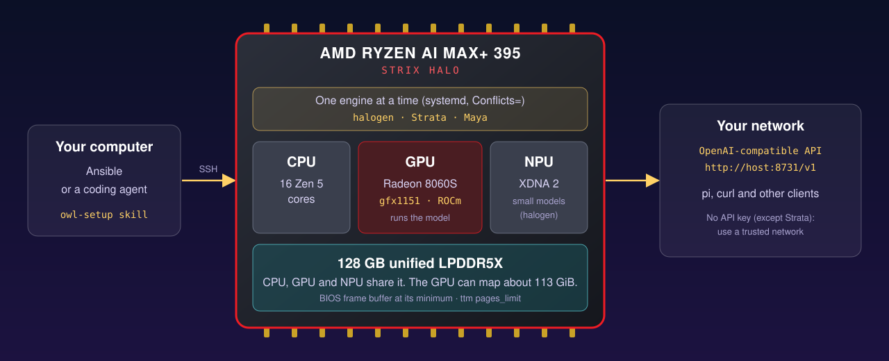

# 2. ROCm and GPU memory

## ROCm

AMD's apt repository stops at ROCm 7.2.4 and has no Ubuntu 26.04 (`resolute`) packages.
The `rocm` role installs the AMD TheRock build for `gfx1151` instead. The Strata Strix Halo guide uses the same build.

| Item | Value |
|------|-------|
| Archive | `https://repo.amd.com/rocm/tarball-multi-arch/therock-dist-linux-gfx1151-7.14.1.tar.gz` |
| SHA-256 | `c40e8f2bd6630a7d11557c762b99c6fa8afb04c9bd0e51ed1675ee1ca24afb00` |
| Install path | `/opt/rocm-7.14.1`, symlink `/opt/rocm` |
| HIP version | 7.14.60850 |
| Environment | `/etc/profile.d/rocm.sh` |
| Library path | `/etc/ld.so.conf.d/rocm.conf` |

Maya builds with `hipcc` from `/opt/rocm/bin`. The symlink gives that path.

The `base` role adds your user to the `render` and `video` groups, so it can open `/dev/kfd` and `/dev/dri`.

Check the GPU:

```sh
rocminfo | grep -E "Marketing Name|Name: +gfx"
```

Expected: `AMD RYZEN AI MAX+ 395 w/ Radeon 8060S` and `gfx1151`.

## Memory split

The CPU and the GPU share 128 GB. Two settings control how the GPU uses it.



### 1. BIOS: UMA frame buffer

Set it to the minimum (see [01-ubuntu-install.md](01-ubuntu-install.md#bios)). Ansible cannot set it. Check:

```sh
free -g                                                    # about 120 GB total
cat /sys/class/drm/card*/device/mem_info_vram_total        # small value
```

### 2. Kernel: ttm page limit

`/etc/modprobe.d/ttm.conf`:

```text
options ttm pages_limit=29637703 page_pool_size=29637703
```

This lets the GPU map about 113 GiB (29637703 pages of 4 KiB) on a 128 GB machine with a 2 GB frame buffer.
Set `ttm_pages_limit` in `ansible/inventory/group_vars/all.yml`.
The `rocm` role rebuilds the initramfs and reboots one time, so the setting is active.

Check:

```sh
cat /sys/module/ttm/parameters/pages_limit                 # 29637703
```
